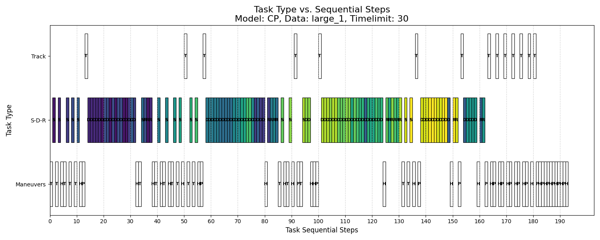
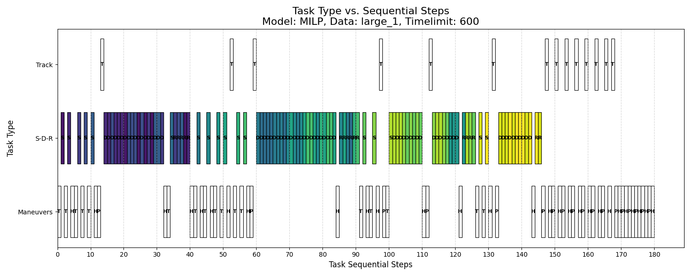

# 衛星任務排程 / Satellite Mission Scheduling

> 國立清華大學 工業工程與工程管理學系 — 畢業專題（第十組）
> National Tsing Hua University, Dept. of IEEM — Capstone Project (Team 10)

[](https://github.com/JasonRott/satellite-mission-scheduling)
[](https://www.python.org/)
[](https://www.ibm.com/products/ilog-cplex-optimization-studio)
[](LICENSE)

---

## 專案簡介 / Overview

本專案針對**單顆遙測衛星**的任務排程問題，分別以 **混合整數線性規劃（MILP）** 及 **限制式規劃（CP）** 兩種方法建模並求解，使用 IBM CPLEX / CP Optimizer 進行效能比較。

This project addresses the **single-satellite task scheduling problem**, formulated and solved using both **Mixed Integer Linear Programming (MILP)** and **Constraint Programming (CP)** via IBM CPLEX/CP Optimizer, with systematic performance benchmarking.

**目標 / Objective**:


---

## 關鍵結果 / Key Results

| Time Limit | large_1 MILP | large_1 **CP** | large_2 MILP | large_2 **CP** |
|:---:|:---:|:---:|:---:|:---:|
| 30 s | 75.1% | **100%** | 36.1% | **95.9%** |
| 60 s | 88.6% | **100%** | 36.1% | **95.9%** |
| 600 s | 93.3% | **100%** | 95.9% | **95.9%** |

*Scheduled Task Ratio on large-scale datasets (193 and 266 tasks)*

- CP 在中規模問題比 MILP 快約 **51 倍**（3.29 秒 vs. 169.05 秒）
- CP converges to optimal quality ~**51× faster** than MILP on medium-scale problems

---

## 問題描述 / Problem Description

### 任務類型 / Task Types

| Type | Description | Timing |
|---|---|---|
| **Shoot** | Capture Earth images | Fixed |
| **Download** | Transmit images to ground station (R-type) | Flexible window |
| **Remove** | Delete images to free memory | Flexible window |
| **Track** | Monitor satellite status (J-type contact) | Fixed |
| **T maneuver** | Rotate to shooting angle | Fixed |
| **P maneuver** | Rotate to download angle (before Download) | Fixed |
| **H maneuver** | Rotate to sun direction (after Download) | Fixed |

### 資源限制 / Resource Constraints

- 記憶體 Memory: **1,280,000 Mb**
- 檔名配額 Filename slots: **116**
- 每軌道最大拍攝時間 Max Shoot/orbit: **480 sec**
- 每軌道最大下載時間 Max Download/orbit: **600 sec**

---

## 資料夾結構 / Repository Structure

```
satellite-mission-scheduling/
├── README.md
├── 專題統整文檔.md          # 完整中文統整報告 / Full Chinese summary
│
├── src/
│   ├── cp_model/            # Constraint Programming (docplex.cp)
│   │   ├── cpo_model_original.py   # CP model (main)
│   │   ├── import_data_original.py # Data loader
│   │   ├── write_excel_original.py # Result writer
│   │   ├── validate_solution.py    # Solution validator
│   │   └── run.py                  # Batch test runner
│   │
│   ├── milp_model/          # Mixed Integer Linear Programming (docplex.mp)
│   │   ├── set_variable_t.py       # MILP model (main, 620 lines)
│   │   ├── import_data_original.py # Data loader
│   │   ├── write_excel.py          # Result writer
│   │   └── run.py                  # Batch test runner
│   │
│   └── visualization/       # Gantt chart generation
│       ├── gantt_3rows.py          # 3-row Gantt (Maneuver/SDR/Track)
│       ├── gantt_7rows.py          # 7-row Gantt (per task type)
│       └── run.py                  # Batch chart generator
│
├── data/
│   ├── cp/                  # CP test datasets (small/medium/large)
│   └── milp/                # MILP test datasets (small/medium/large)
│
├── results/
│   ├── gantt_charts/        # 96 PNG Gantt charts
│   │   ├── CP_gantt/
│   │   └── MILP_gantt/
│   └── timing_results/      # Excel timing & performance logs
│
└── docs/
    ├── thesis/              # 書面報告 .docx
    ├── presentations/       # 簡報 .pptx / .pdf
    └── poster/              # 海報 .pdf
```

---

## 環境需求 / Requirements

```
Python >= 3.8
IBM CPLEX Optimization Studio >= 22.1  (with docplex)
pandas
openpyxl
matplotlib
```

> **Note**: IBM CPLEX requires a license. Free Community Edition supports problems up to 1,000 variables.

安裝 Python 套件：

```bash
pip install docplex pandas openpyxl matplotlib
```

---

## 執行方式 / Usage

### 1. 執行 CP 模型（單次）

```bash
cd src/cp_model
# 修改 import_data_original.py 中的資料集路徑後執行：
python cpo_model_original.py
```

### 2. 執行 MILP 模型（單次）

```bash
cd src/milp_model
python set_variable_t.py
```

### 3. 批次測試（所有資料集 × 所有時間限制）

```bash
# CP 批次測試
cd src/cp_model
python run.py

# MILP 批次測試
cd src/milp_model
python run.py
```

### 4. 生成甘特圖

```bash
cd src/visualization
python run.py
# 輸出至 results/gantt_charts/
```

---

## 模型架構 / Model Architecture

### CP 模型（`src/cp_model/cpo_model_original.py`）

```python
# Interval variable for each task
iv_task[tid] = interval_var(start=st, size=dur, optional=True)

# Key global constraints
mdl.add(no_overlap(maneuver_shoot_download_set))   # No-overlap
mdl.add(alternative(d_master, contact_copies))     # Download-contact assignment
mdl.add(if_then(presence_of(ivc), end_of(iv_P) <= start_of(ivc)))  # P→DL→H order

# Memory/file via cumulative pulse
mdl.add(sum(memory_profile) <= Memory_value)       # Cumulative resource
```

### MILP 模型（`src/milp_model/set_variable_t.py`）

```python
# Binary decision: execute task or not
x_task[tid] = mdl.binary_var()

# Continuous: start time for Download/Remove
start_time[tid] = mdl.continuous_var(lb=0)

# Big-M no-overlap linearization
mdl.add(start_time[i] >= start_time[j] + dur_j - M*(1-z_ij) - M*(2-x_i-x_j))
mdl.add(start_time[j] >= start_time[i] + dur_i - M*z_ij   - M*(2-x_i-x_j))
```

---

## 實驗結果示例 / Sample Results

### CP 模型甘特圖（large_1，30 秒，100% 任務完成）



### MILP 模型甘特圖（large_1，600 秒，93.3% 任務完成）



---

## 測試資料集 / Benchmark Instances

| Dataset | Tasks | Scale |
|---|---|---|
| small_1 | 61 | Small |
| small_2 | 69 | Small |
| medium_1 | 104 | Medium |
| medium_2 | 112 | Medium |
| large_1 | 193 | Large |
| large_2 | 266 | Large |

---

## 技術棧 / Tech Stack

- **最佳化求解器**: IBM CPLEX + CP Optimizer
- **Python API**: `docplex.mp` (MILP), `docplex.cp` (CP)
- **資料處理**: pandas, openpyxl
- **視覺化**: matplotlib

---

## 作者 / Authors

| 學號 | 姓名 |
|---|---|
| 111034010 | 羅彥凱 |
| 111034017 | 黃冠捷 |
| 111034043 | 蔡坤憲 |

**指導教授 / Advisor**: 林東盈 博士（Dr. Dong-Ying Lin）
**系所 / Department**: 工業工程與工程管理學系，國立清華大學
**完成日期 / Date**: December 2025

---

## 參考文獻 / References

1. IBM ILOG CPLEX Optimization Studio CP Optimizer User's Manual, Version 12 Release 6.0, IBM Corp., 2013.
2. IBM Decision Optimization CPLEX Modeling for Python: DOcplex.MP Reference Manual (Version 2.30), IBM Corp., 2022.
3. Rossi, van Beek & Walsh (2006). *Handbook of Constraint Programming*. Elsevier.
4. Régin (1994). A filtering algorithm for constraints of difference in CSPs. *AAAI*.
5. Vasquez & Hao (2001). A 'logic-constrained' knapsack formulation for earth observation satellite scheduling. *Comput. Optim. Appl.*, 20(2), 137–157.
6. Ferrari et al. (2025). Satellite scheduling problems: A survey. *Comput. Oper. Res.*, 173, 106875.
